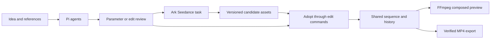

<div align="center">

# Framo

**Describe a story. Shape every frame.**

A desktop video studio where an agent, a canvas, and a timeline work on the same project.

[Quick start](#quick-start) · [How it works](#how-it-works) · [Kits](#kits) · [Development](#development) · [中文](README.zh-CN.md)

</div>

**Framo** is a further shortening of **frame operation**.

Framo brings planning, Seedance generation, candidate review, and precise editing into one macOS workspace. Ask the agent for a shot, inspect the proposal, adopt the result, and keep shaping the film yourself.

**Model configuration is required.** This first release generates video with **Seedance only** through Volcengine Ark. Pi reasoning uses a separate tool-capable, image-capable Ark chat model. Bring your own API key and model access; local test fixtures are not an offline creative mode.


## Quick start

1. Download the macOS Apple Silicon build from [Releases](https://github.com/ItsToddx/framo/releases).
2. This preview is not Developer ID signed or notarized. If macOS blocks it, follow [Apple’s Open Anyway instructions](https://support.apple.com/102445) for a build you have verified.
3. Open Framo and configure your Ark API key, chat model or endpoint ID, and Seedance model ID in **Settings**. Both models must be available to that account.
4. Create a project. Import a reference image or footage, or describe your idea in the agent panel.
5. Review generation parameters and the spending estimate before submission. Seedance outputs appear as candidates in your asset library.
6. Add or replace a timeline clip, edit captions and sound, compose a preview, and export MP4.

Try a request such as:

> Plan a five-second product reveal from the selected image. Keep the film in 16:9, explain the generation settings, and propose the shot for review before submitting it.

Ark bills model requests to your own account. The app stores the key using macOS credential encryption, outside projects. A user-entered budget is a submission guard and estimate, not a guarantee of the provider's final bill.

### Interface language

The interface starts in **English**. Choose **简体中文** in the language selector in the top bar or any dialog. Your choice is saved on this computer; switching keeps conversations, form inputs, and timeline drafts intact. Authored names, messages, and custom Kit content keep their original language.

### Upgrading an existing profile

Existing projects and shared archives remain readable, and built-in workflow identities stay fixed. macOS may require re-entering the API key under the new application identity. Explicitly saving a replacement preserves an unreadable old encrypted vault as a backup; it never remaps old tasks to the new account or replays their paid submissions.

## What you can do

| Workspace | Behavior                                                                                                                            |
| --------- | ----------------------------------------------------------------------------------------------------------------------------------- |
| Canvas    | Arrange and select asset and film cards; hide a card without deleting its media.                                                    |
| Agent     | Plan with a coordinator and creative, visual and editing specialists; review every edit or paid generation.                         |
| Timeline  | Add tracks and clips, move, trim, split, delete and replace; adjust gain and mute; edit caption text, timing and style.             |
| History   | Manual and agent edits share one revision-checked undo/redo history. Canvas history is separate.                                    |
| Media     | Compose preview and final export from the same saved sequence, with H.264 video and AAC audio.                                      |
| Tasks     | Keep durable Seedance task IDs, query original tasks after restart, and collect candidates without resubmitting uncertain requests. |
| Memory    | Review suggested preferences before saving; view, edit and forget project or user memories.                                         |
| Kits      | Install, enable and remove creative capabilities; share declarative recipes or explicitly trust a native code Kit.                  |
| Projects  | Save in a project directory and reopen it; share media and edit data without account keys, chats or execution records.              |

## A focused creative workspace

A light studio keeps references and Agent decisions visible. Opening a work gives the composed preview and timeline the main workspace. Drag or use frame keyboard controls to move and trim; changes remain a protected draft until Save or Discard.

The assistant-ui conversation projects the actual persisted session, tools and streamed reply. Plans, exact reviews, workflow steps and output candidates are readable working surfaces. Drafts survive tab/session changes and rejected sends; IME input and reading older messages keep their expected behavior.

Domain objects and portable application use cases follow inward dependencies. Repository, runtime, provider and media interfaces isolate SQLite, Electron, Pi and FFmpeg. See [architecture](docs/architecture.md), [application boundaries](packages/application/README.md) and [domain vocabulary](GLOSSARY.md).

## How it works



The canvas describes your workspace; the sequence describes playback; a Job describes execution. Moving a card does not reorder the film. Generation never silently replaces an adopted clip. Replacing one shot preserves its identity, timing, volume and captions.

Timeline positions are integer frame ticks. Source offsets are seconds. Preview and export use the same composition mapping and half-open frame intervals. Export is published only after checking frame count, dimensions, duration, audio and full-file decoding.

## Kits

**Every Kit. A new way to create.**

A Kit can provide a media provider, read/edit/job tools, specialist agents, or a reusable recipe. Built-in capabilities use the same public SDK as external authors.

- Start with [the Kit guide](docs/kits.md) and [the SDK](packages/kit-sdk).
- Try [the caption-case code Kit](kits/examples/caption-case), which proposes caption changes without writing the project.
- Export a declarative recipe from the app. Shared Kits contain parameters and definitions, not keys, private media or run state.

Native Kits run in a background process for fault isolation. They have the operating-system permissions of your account; they are **trusted code**, not an adversarial-code sandbox. Installation shows source, permissions and a content digest before activation. Imported projects do not execute Kits.

The curated catalog lives in this repository. See [catalog contributions](docs/kits.md#catalog-contributions).

## Development

Requirements: macOS Apple Silicon, Node.js 22.13 or newer, and Apple command line tools for the media build.

```bash
git clone https://github.com/ItsToddx/framo.git
cd framo
npm ci
npm run media:build
npm run dev
```

```bash
npm run typecheck
npm test
npm run build
npm run test:desktop
npm run test:desktop-failures
npm run test:desktop-ui
npm run format:check
npm run dist:mac
```

`media:build` builds standalone FFmpeg and FFprobe from pinned official source. The macOS build uses VideoToolbox for H.264, rasterizes captions in the host, and does not enable GPL or nonfree FFmpeg components. Release media source and build information accompany the binaries.

Tests use temporary projects and fake account strings in an isolated profile. Pi protocol tests stream through a local test server; provider contract tests use fixtures. Real cloud acceptance needs an account with the configured models and an explicitly approved budget. See [verification](docs/verification.md) for the distinction.

## Project layout

```text
apps/desktop/src/   Electron shell, isolated preload, React workbench and adapters
packages/core/         Domain editing, generation and recipe rules
packages/application/  Portable use cases, owned contracts and ports
packages/kit-sdk/  Public Kit contracts, validation and registration
kits/              Built-in capabilities and independent examples
resources/         Native media tools and redistribution notices
tests/             Editing, persistence, providers, agents, Kits and real rendering
docs/              Architecture, Kits, validation and release notes
```

## Support and contribution

macOS Apple Silicon is the initial supported platform. Windows and Intel macOS are not release targets yet. Advanced transitions, speed ramps and keyframe effects are outside the first editing format. Seedance cancellation depends on provider state; requesting cancellation does not mean a running cloud task stopped or was refunded.

Use [Issues](https://github.com/ItsToddx/framo/issues) for reproducible bugs and proposals. Read [CONTRIBUTING](CONTRIBUTING.md) before changing the project format or SDK.

## Inspiration and dependencies

README organization is inspired by [Hyperframes](https://github.com/heygen-com/hyperframes). Workspace and interaction ideas draw from MiniMax Design, ChatCut and Toonflow; specialist roles from ViMax; canvas interaction from React Flow. These are design references, not claims of integrating their applications or copying private code.

The light design system follows guidance from [UI UX Pro Max](https://github.com/nextlevelbuilder/ui-ux-pro-max-skill) and [shadcn/ui](https://github.com/shadcn-ui/ui), with source-owned Radix primitives. Conversations use the actual [assistant-ui](https://github.com/assistant-ui/assistant-ui) ExternalStoreRuntime over desktop IPC.

The implementation uses [Electron](https://www.electronjs.org/), [Pi](https://github.com/badlogic/pi-mono), [React Flow](https://reactflow.dev/), SQLite and [FFmpeg](https://ffmpeg.org/). Generation follows [Ark's Seedance API](https://docs.volcengine.com/docs/ark/create-video-generation-task-api?lang=zh). Hyperframes motion rendering is a separately evaluated extension; it does not replace the sequence model. See [third-party notices](THIRD_PARTY_NOTICES.md).

## License

Framo and the Kit SDK are Apache-2.0. Third-party libraries, media tools and your source assets retain their own licenses.
