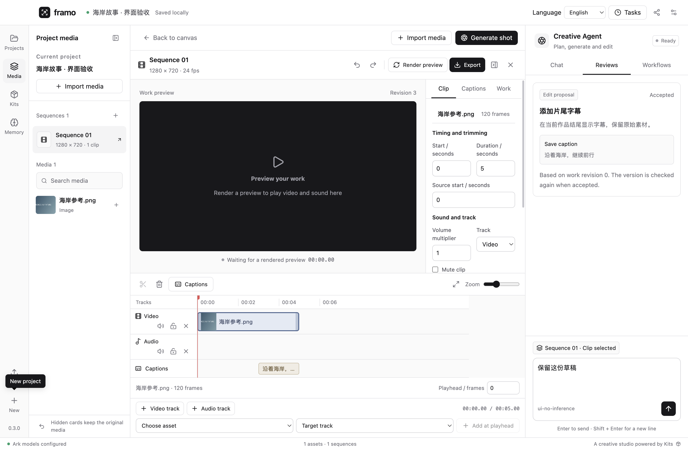

# Framo

**把想法，打磨成下一个镜头。**

**Framo** 是 **frame operation** 的进一步缩写。

Framo 是 macOS 桌面视频 Agent。画布整理素材，对话推进创作，时间线完成精调；人工与 Agent 修改同一份作品。

[安装与使用](#安装与使用) · [创作套件](docs/kits.md) · [技术架构](docs/architecture.md) · [验证说明](docs/verification.md) · [English](README.md)



界面默认使用 **英文**，同时支持 **简体中文**。在顶部或弹窗的语言选择器中切换；选择会保存到本机，切换时保留对话、表单和时间线草稿。用户与模型内容保持原文。

## 安装与使用

1. 从 [GitHub Releases](https://github.com/ItsToddx/framo/releases) 下载 Apple Silicon 版。
2. 在设置中填写火山方舟 API Key、支持工具调用的 Agent 模型或接入点 ID，以及 Seedance 模型 ID。
3. 创建工程，导入参考图片或已有视频，在右侧对话提出创作目标。
4. 检查 Agent 提案、生成参数与预算，确认后提交；生成结果先进入素材库。
5. 将候选加入或替换时间线片段，调整字幕、音量、剪辑，合成预览并导出 MP4。

**创作必须配置模型。第一版视频生成只支持 Seedance。** Seedance 负责生成视频，Pi 通过方舟语言模型理解需求和调用工具；两者分别配置模型 ID，使用你的方舟账户。

模型服务按你的账户计费。密钥使用系统加密保存在应用配置中，不写入工程或共享文件。生成预算用于提交前确认和拦截，不能保证供应商最终计费不超过估计。

## 主要能力

- 浅色工作台与持续可见的 Agent 对话；打开作品后，预览与时间线占据主要编辑区域。
- 创作、视觉、剪辑专业 Agent；编辑与付费生成均先提出审阅。
- 添加轨道与片段、拖动与逐帧键盘移动/裁剪、分割、删除、替换、音量、静音、字幕与样式；草稿明确保存或放弃。
- 人工与 Agent 共用撤销栈；版本冲突先重读，不覆盖未核对的修改。
- 保存重开、项目与个人记忆、任务恢复、候选采纳、合成预览与检查后的 MP4 导出。
- Kit 安装、启停、卸载、配方分享与受信任代码扩展。

移动画布卡片只整理工作区；移动时间线片段才改变播放位置。更换镜头默认保留片段 ID、位置、时长、音量和字幕。提交结果不明时只查原任务，不自动重新付费生成。

## 从源码运行

需要 macOS Apple Silicon、Node.js 22.13+ 和 Apple command line tools。

```bash
git clone https://github.com/ItsToddx/framo.git
cd framo
npm ci
npm run media:build
npm run dev
```

验证和打包：

```bash
npm run typecheck
npm test
npm run build
npm run test:desktop
npm run test:desktop-failures
npm run test:desktop-ui
npm run format:check
npm run dist:mac
```

测试使用独立临时工程、受控模型接口和原生 FFmpeg；不会使用你的真实账户发起付费任务。真实 Seedance 联调需要你配置账户并明确确认预算。

## 实现与兼容

应用用例与领域规则通过向内依赖隔离 Electron、SQLite、Pi、Seedance 和媒体处理细节。具有实际状态约束的生成任务、生成订单、请求预算与用例对象负责规则和执行；Repository、Gateway、Command 与 Facade 模式用于可替换的边界。详见[架构](docs/architecture.md)与[领域词汇](GLOSSARY.md)。

已有工程、共享包和内置 Kit 引用保持兼容；改名不会重发付费任务。

从旧版升级时，macOS 可能无法用新应用身份读取旧密钥，请在设置中重新输入。保存新密钥时会保留原加密文件备份；旧任务的账户绑定不会被替换为新密钥。

## 创作套件

**Every Kit. A new way to create. 一个 Kit，多一种创作可能。**

开发者通过公开 SDK 增加能力；创作者把制作流程导出为配方，让其他人换自己的素材使用。[Kit 指南](docs/kits.md)说明接口、安装、信任与版本管理。

原生代码 Kit 在后台进程执行，具有当前系统账户的权限；进程隔离用于故障恢复，不能当作恶意代码沙箱。安装时查看来源与权限，只启用受信任的包。

## 参考与许可

浅色设计系统参考 [UI UX Pro Max](https://github.com/nextlevelbuilder/ui-ux-pro-max-skill) 与 [shadcn/ui](https://github.com/shadcn-ui/ui)，使用源码维护的 Radix 控件；对话实际接入 [assistant-ui](https://github.com/assistant-ui/assistant-ui) 的 ExternalStoreRuntime。

README 的组织方式参考 [Hyperframes](https://github.com/heygen-com/hyperframes)。产品交互参考 MiniMax Design、ChatCut、Toonflow，专业 Agent 分工参考 ViMax；实际栈为 Electron、Pi、React Flow、SQLite 与 FFmpeg。第一版不接入 ComfyUI。

项目与 Kit SDK 使用 Apache-2.0；第三方组件、媒体工具和素材保留各自许可。详见 [第三方声明](THIRD_PARTY_NOTICES.md)。

当前安装包为预览版，尚未使用 Apple Developer ID 签名或公证。若 macOS 阻止打开已核对的构建，请按 [Apple 官方说明](https://support.apple.com/102445)在隐私与安全性中选择“仍要打开”。Agent 需要支持工具调用和图片输入的方舟语言模型；视频生成仅支持 Seedance。
