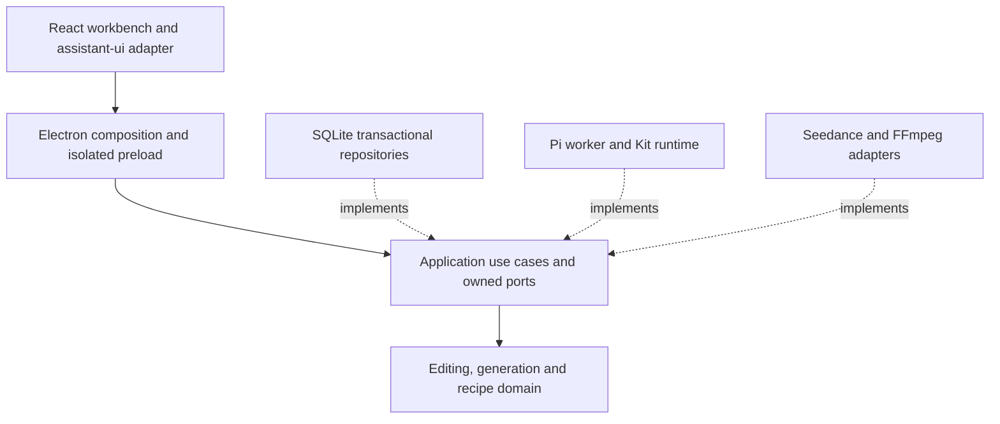

# Architecture

Frameo is an Electron desktop studio with inward dependencies. The renderer owns selection and unsaved gestures; portable application objects own creative operations; core objects guard the rules that make those operations safe. Frameworks, storage, workers and providers are composed at the desktop boundary.

## Domain responsibilities

`EditSequence` applies commands through an atomic transaction seam. It validates immutable media references, integer frame timing, track constraints and revision conflicts; undo and redo restore content through the same rules. A source asset is never trimmed in place.

`GenerationOrder` is a value object that freezes model, account, reference version and budget. `GenerationTask` is an aggregate guarding one paid submit, fixed remote identity, cancellation acknowledgement, verified staging and candidate completion. A missing submission response is unknown. It never means permission to submit again.

Recipe rules resolve dependency graphs, bound input/result identities and step attempts. `RequestBudget` counts one original request and all specialists against the same model, tool and duration limits. See [GLOSSARY](../GLOSSARY.md) for the user-facing vocabulary.

## Application operations

The portable [`packages/application`](../packages/application/README.md) package owns `ProjectWorkspace`, `GenerationJobs`, `AgentExecution`, `ReviewDecisions`, `RecipeExecutionService` and `EditCoordinator`. Its repository, gateway, media, catalog, history and runtime interfaces are defined beside the operations that consume them. It imports core rules and plain Kit declarations, never Electron, SQLite, Pi, React, filesystem or provider implementations.

`ProjectStore` commits content, history, receipts and the event cursor together. Canvas layout has separate history. `GenerationJobs` coordinates queueing, reconciliation and output finalization. `AgentExecution` owns active request identity, stopping, preparation and interrupted-run recovery. `ReviewDecisions` binds acceptance to the exact revision, Kit digest, frozen parameters and draft lease. Recipe input/result reviews remain distinct from accepting a proposal created by a step.

Patterns serve these boundaries: Repository and transactional Unit of Work isolate persistence; gateway Strategies isolate model/media variation; commands and use-case objects encapsulate creative actions; the desktop Facade preserves the existing API. Composition replaces inheritance for runtime/provider dependencies. Policies can run with in-memory storage and fixture gateways.

## Desktop and rendering adapters

The sandboxed preload exposes named APIs. The host checks sender, frame and schema before dispatching through a command map checked against `DesktopApi`. React cannot access Node or arbitrary local files. The local media scheme serves only registered sources, cache and outputs, with byte ranges for playback.

The assistant-ui ExternalStoreRuntime projects persisted messages and the current session's stream. Host IPC remains the only source of model calls and task state. Composer drafts survive failed sends, session changes and tab changes; an IME Enter does not submit. Tool traces, exact reviews, step decisions and project tasks remain separate surfaces.

The editor stages manual changes under a lease. Move/trim gestures produce frame-constrained command proposals with Save/Discard and keyboard alternatives. FFmpeg preview and export use the same frame mapping, video/audio normalization and rasterized caption composition. Outputs are written temporarily, verified and atomically published.

Pi and native Kits run in background workers. Specialists share a persisted request budget and stop gate; their text is not an edit receipt. Native Kit code executes with the user's OS privileges only after explicit source/permission trust. Declarative sharing never executes installed code.

## Persistence and compatibility

Projects retain `project.sqlite`, `media/`, `cache/`, `sessions/` and `snapshots/`, with format version 1. Opening an existing project first snapshots SQLite and retains three backups. Shared archives omit credentials, personal memory, chats, tasks and approvals, and acquire a new project identity on import.

Frameo accepts legacy project directories and shared archives. Built-in capability identifiers remain stable so authored workflows keep their references. The profile selector reuses a prior desktop profile when no Frameo profile exists; credentials stay encrypted in that profile. If the new app identity cannot decrypt the legacy vault, explicit replacement preserves its ciphertext backup and creates a new account reference; old task account references are never remapped. Renaming does not rewrite source files or generation orders.

Interrupted worker reservations remain conservative and orphan steps become interrupted. Active paid work is never replayed. Existing remote IDs can be reconciled; verified staged output can be finalized without a fresh paid call or an expiring provider URL. A generated candidate enters the timeline only after explicit adoption.

## Verification

Architecture tests enforce dependency direction and exercise generation, recovery, exact reviews and Agent preparation against in-memory ports. Concrete adapter tests cover SQLite history/receipts, provider failures, shared budgets, Kit trust and native media composition. Electron acceptance exercises actual IPC, draft leases, reviews, reopening and frame-exact exports. Synthetic UI fixtures and existing generated media require no new paid inference.
